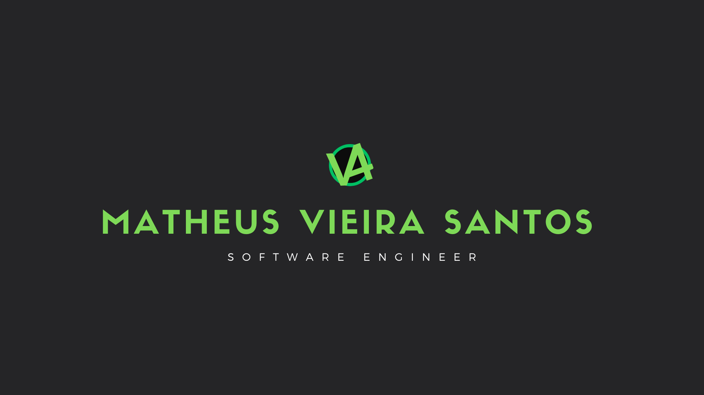

## Hey there! 👋

### 🍰 About me

I'm **Matheus Vieira Santos**, I am a senior software engineer currently living and working in Spain. I like to think of myself as an extroverted, excited and proactive person. I really do believe in the transforming power of education and, in this perspective, I'm always engaged in different projects.

### 🎓 Education

I hold a Master's degree in Web Engineering from the Polytechnic University of Madrid (UPM), a Bachelor's degree in Computer Science from the Federal University of Fronteira Sul (UFFS), and I am a Computer Science Technician graduate from the Federal Institute of Santa Catarina (IFSC).

### ⚒️ Work

I have been working in software engineering since 2020, with experience in both backend and full-stack development. Throughout my career, I have worked across different companies and teams, developing software solutions and expanding my expertise in backend systems, APIs, and full-stack applications.

My professional experience includes roles at Questor Systems, Stone Co., and Business Insights, where I progressed from trainee and junior positions to mid-level and senior-level responsibilities. I currently work at Pepper Advantage, continuing to build on my experience in software engineering, with a strong focus on backend development and full-stack solutions.

### ✨ Cool stuff about me

- 🌎 I participated in two exchange programs, one in Portugal and another in Spain
- ⚙️ I took courses in many different fields, such as electrics, mechanics, administration, theater and design
- 🗣️ I speak four languages (Portuguese, Spanish, English and Italian)
- 🧑‍🏫 I taught English classes for a year when I was in High School
- 🏅 I won some medals and honor certificates through Math Olympics in High School

### 📫 Contact

- ✉️ Hit me up anywhere @vieir4ndo or feel free to send me an e-mail at matheus.eu.mv@gmail.com

    

